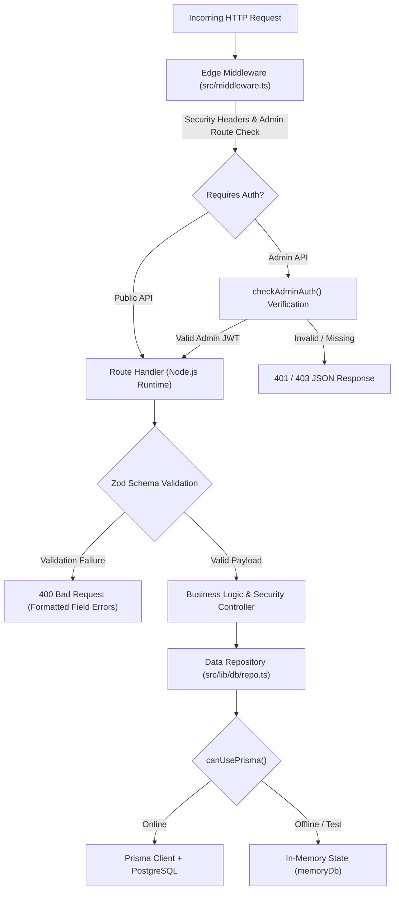
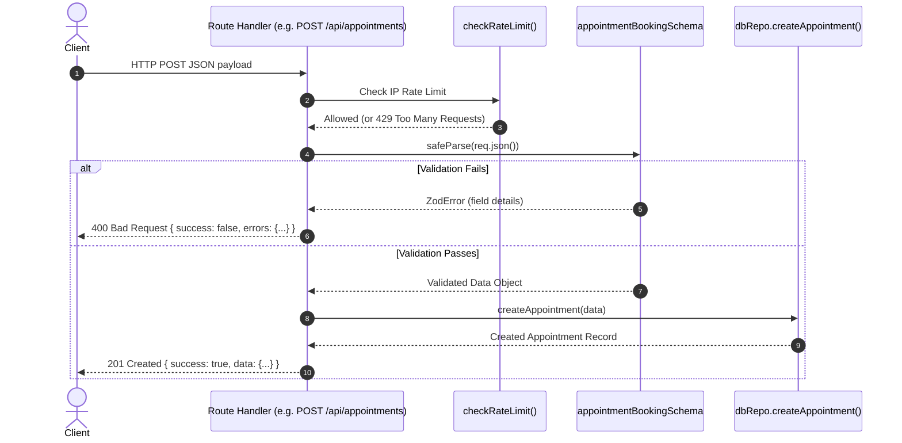

# Backend Architecture Documentation: The Jawed Habib Salon – Lalganj

> **Document Status**: Production Verified  
> **Backend Framework**: Next.js 14.2.20 Route Handlers (Node.js Runtime)  
> **Validation Engine**: Zod 3.23.8 | **Authentication**: JWT + Bcrypt.js + HttpOnly Cookies  
> **Security Standards**: AES-256-GCM Credential Encryption & Sliding-Window Rate Limiting  
> **Developer Attribution**: Designed & Developed by [Axivon Technologies](https://axivontech.in)

---

## 1. Backend Architecture Overview

The backend architecture is implemented using **Next.js Route Handlers** (`src/app/api/*`) executing in the Node.js runtime. It provides a robust, decoupled RESTful API serving both the public customer interface and the administrative control center.



---

## 2. Authentication & Session Architecture

### A. Token Management
- **Format**: JSON Web Tokens (JWT) signed via `jsonwebtoken` using HMAC-SHA256 and the server environment secret `JWT_SECRET`.
- **Payload Contents**:
  ```ts
  interface TokenPayload {
    userId: string;
    role: "SUPER_ADMIN" | "ADMIN" | "MANAGER" | "STAFF" | "CUSTOMER";
    phone: string;
    email?: string | null;
  }
  ```
- **Cookie Delivery**:
  Delivered in the `Set-Cookie` header as `habib_session_token` with:
  - `httpOnly: true` (Shielded against XSS extraction).
  - `secure: true` in production (Transmitted strictly over HTTPS).
  - `sameSite: "lax"` (Mitigates CSRF vulnerabilities).
  - `maxAge`: Dynamic lifespan — **30 days** when "Remember Me" is selected; **7 days** standard.
  - `path: "/"`

### B. Password Hashing
- Utilizes `bcryptjs` with a cost factor of **10 salt rounds** for all stored user passwords.
- Password comparison via constant-time `bcrypt.compare()` mitigates side-channel timing attacks.

### C. Role-Based Access Control (RBAC)
Authoritative permissions are verified in `src/lib/auth/rbac.ts`:
- **Roles Defined**:
  - `SUPER_ADMIN` (Hierarchy 100): Full operational, system, and financial privileges.
  - `ADMIN` (Hierarchy 80): Full appointment, service, customer, and media privileges.
  - `MANAGER` (Hierarchy 60): Appointment and stylist scheduling, customer notes.
  - `STAFF` (Hierarchy 40): View assigned appointments and mark service completion.
  - `CUSTOMER` (Hierarchy 10): Access personal booking history and loyalty rewards.
- **Verification Helper**: Every administrative route handler invokes `checkAdminAuth(req)`, rejecting unauthorized calls with `HTTP 401 Unauthorized` or `HTTP 403 Forbidden`.

---

## 3. Request Lifecycle & Validation Layer

Every mutating API endpoint (`POST`, `PUT`, `PATCH`, `DELETE`) enforces strict server-side validation using **Zod** schemas defined in `src/lib/validation/schemas.ts`:



### Key Validation Schemas:
1. `loginSchema`: Validates `phoneOrEmail` (min 3 chars), `password` (min 6 chars), and optional `rememberMe` boolean.
2. `appointmentBookingSchema`: Enforces customer name, 10-digit Indian phone number (`/^[6-9]\d{9}$/`), future appointment date, 30-min slot alignment, and valid service/package IDs.
3. `adminServiceSchema`: Enforces service name, unique slug, non-negative price, duration (5 to 480 mins), and category foreign key.
4. `adminRazorpaySettingsSchema`: Enforces valid `keyId` structure (`rzp_test_...` or `rzp_live_...`), encrypted `keySecret`, and webhook secrets.

---

## 4. Scheduling & Concurrency Engine

The appointment scheduling engine ([`src/lib/db/repo.ts`](file:///c:/Users/vk010/Downloads/startup/demo/The%20Jawed%20Habib%20Salon%20-%20Lalganj/src/lib/db/repo.ts)) manages time-slot availability, concurrency, and collision prevention:

1. **Operating Hours Rules**:
   - Fixed salon ground truth: **Monday – Sunday: 10:00 AM – 10:00 PM (All 7 Days)**.
   - Slot interval: **30 minutes** (e.g., 10:00, 10:30, 11:00 ... 21:30).
2. **Advance Booking Horizon**:
   - Maximum booking period: **30 days** in advance. Bookings attempted beyond 30 days are rejected with `CONFLICT_CLOSED`.
3. **Concurrency & Capacity Control**:
   - Configurable `maxBookingsPerSlot` (default: 2 simultaneous bridal/salon appointments per slot).
   - If slot capacity is reached, `/api/appointments/availability` removes the slot from the public calendar, returning an immediate `409 Conflict` if two users attempt concurrent checkout.
4. **Temporary Slot Holds (`/api/appointments/hold`)**:
   - When a user enters Step 3 of checkout, a 10-minute hold token is created in `TimeSlotHoldRecord`.
   - Hold tokens automatically expire after 600 seconds, releasing the slot if payment is not initiated.

---

## 5. File Upload & Media Asset Engine

Administrative image uploads are handled via `/api/admin/upload`:
- **Local Storage**: Files uploaded in development/local environments are saved to the public media directory with unique cryptographic hashes to prevent collisions.
- **Cloudinary Integration**: When `CLOUDINARY_API_KEY` and `CLOUDINARY_API_SECRET` are configured, assets are uploaded directly to the Cloudinary CDN under the `jawed_habib_lalganj` folder, returning optimized HTTPS delivery URLs.
- **Media Asset Registry**: All uploaded assets are indexed in the `Media` repository ([`/admin/media`](file:///c:/Users/vk010/Downloads/startup/demo/The%20Jawed%20Habib%20Salon%20-%20Lalganj/src/app/admin/media/page.tsx)) categorized into `bridal`, `interior`, `transformations`, or `general` folders.

---

## 6. Audit Logging & System Notifications

1. **Audit Logs (`AuditLog` / `dbRepo.logAudit`)**:
   - All critical administrative mutations (status changes, price updates, package publishing, staff reassignments, and payment recordings) are logged with timestamp, user ID, entity type, entity ID, and a JSON diff payload.
2. **Administrative Notification Queue (`Notification` / `dbRepo.notifyAdmins`)**:
   - System automatically generates high-priority notifications when an online appointment is placed, an advance payment is captured, or a booking is cancelled.
   - Notifications surface in real-time in the universal admin topbar badge.
