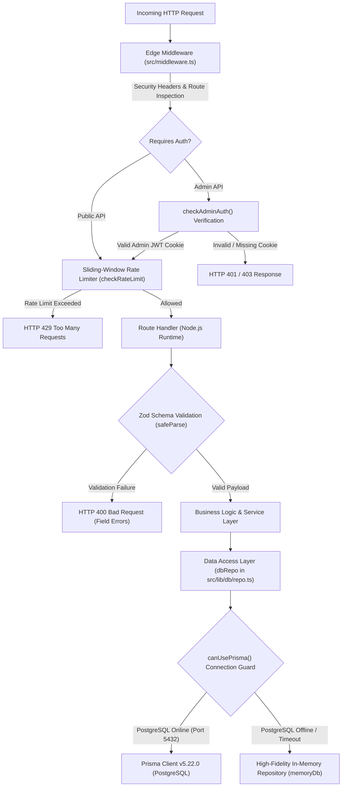
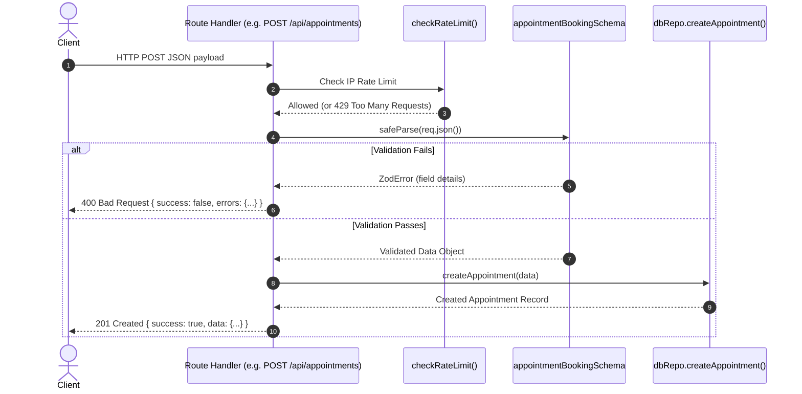

# Backend Architecture Documentation: The Jawed Habib Salon – Lalganj

> **Document Version**: 2.0.0 (Production Verified & Performance Optimized)  
> **Backend Framework**: Next.js 14.2.20 Route Handlers (Node.js Runtime)  
> **Validation Engine**: Zod 3.23.8 | **Authentication**: JWT + Bcrypt.js + HttpOnly Cookies  
> **Security Standards**: Authenticated AES-256-GCM Encryption, HMAC-SHA256 Signatures, Sliding-Window Rate Limiting  
> **Developer Attribution**: Designed & Engineered by [Axivon Technologies](https://axivontech.in)

---

## 1. Backend Architecture Overview

The backend architecture is implemented using **Next.js App Router Route Handlers** (`src/app/api/*`) executing in the Node.js runtime. It provides a robust, decoupled RESTful API serving both the public customer interface and the administrative management hub.



---

## 2. Authentication & Session Architecture

### A. Token Management
- **Format**: JSON Web Tokens (JWT) signed via `jsonwebtoken` using HMAC-SHA256 and the server environment secret `JWT_SECRET`.
- **Payload Schema**:
  ```ts
  interface TokenPayload {
    userId: string;
    role: "SUPER_ADMIN" | "ADMIN" | "MANAGER" | "STAFF" | "CUSTOMER";
    phone: string;
    email?: string | null;
  }
  ```
- **Cookie Delivery**:
  Delivered in the `Set-Cookie` header as `habib_session_token` with:
  - `httpOnly: true` (Shielded against XSS extraction).
  - `secure: true` in production (Transmitted strictly over HTTPS).
  - `sameSite: "lax"` (Mitigates CSRF vulnerabilities).
  - `maxAge`: Dynamic lifespan — **30 days** when "Remember Me" is selected; **7 days** standard.
  - `path: "/"`

### B. Password Hashing
- Utilizes `bcryptjs` with a cost factor of **10 salt rounds** for all stored user passwords.
- Password comparison via constant-time `bcrypt.compare()` mitigates side-channel timing attacks.

### C. Role-Based Access Control (RBAC)
Authoritative permissions are verified in `src/lib/auth/rbac.ts`:
- **Roles Defined**:
  - `SUPER_ADMIN` (Hierarchy 100): Full operational, system, and financial privileges.
  - `ADMIN` (Hierarchy 80): Full appointment, service, customer, and media privileges.
  - `MANAGER` (Hierarchy 60): Appointment and stylist scheduling, customer notes.
  - `STAFF` (Hierarchy 40): View assigned appointments and mark service completion.
  - `CUSTOMER` (Hierarchy 10): Access personal booking history.
- **Verification Helper**: Every administrative route handler invokes `checkAdminAuth(req)`, rejecting unauthorized calls with `HTTP 401 Unauthorized` or `HTTP 403 Forbidden`.

---

## 3. Request Lifecycle & Validation Layer

Every mutating API endpoint (`POST`, `PUT`, `PATCH`, `DELETE`) enforces strict server-side validation using **Zod** schemas defined in `src/lib/validation/schemas.ts`:



### Key Validation Schemas:
1. `loginSchema`: Validates `phoneOrEmail` (min 3 chars), `password` (min 6 chars), and optional `rememberMe` boolean.
2. `appointmentBookingSchema`: Validates customer name, 10-digit Indian phone number (`/^[6-9]\d{9}$/`), service IDs, date, time slot, and advance deposit.
3. `paymentOrderSchema`: Validates `appointmentId` and `paymentPurpose` without accepting client amounts.
4. `paymentVerifySchema`: Validates `razorpay_order_id`, `razorpay_payment_id`, and `razorpay_signature`.
5. `collectRemainingPaymentSchema`: Validates offline balance collection, enforcing that the collected amount does not exceed the outstanding balance.

---

## 4. Performance Optimizations & Caching Strategy

1. **Database Indexing**:
   Single and composite indexes prevent full table scans on high-traffic queries:
   - `Appointment(packageId)`
   - `Appointment(appointmentDate, status)`
   - `Appointment(customerProfileId, status)`
   - `Service(categoryId, isActive)`
   - `PaymentRecord(gatewayPaymentId)` & `PaymentRecord(createdAt)`
   - `OfflinePaymentRecord(createdAt)` & `OfflinePaymentRecord(receivedDate)`
   - `CustomerProfile(totalSpent)`
2. **N+1 Query Elimination**: Multi-entity reads use Prisma relation includes (`customerProfile.user`, `appointmentServices.service`, `payments`, `staff`).
3. **Safe Caching Headers**:
   - Public catalogs (`/api/services`, `/api/packages`, `/api/gallery`) leverage edge caching with `Cache-Control: public, s-maxage=300, stale-while-revalidate=600`.
   - Real-time endpoints (`/api/appointments`, `/api/payments/*`, `/api/admin/*`) declare `export const dynamic = "force-dynamic"` to guarantee real-time data freshness without stale cache poisoning.
4. **Connection Pooling**: PostgreSQL connection limit set to 10 with timeout guards to prevent pool exhaustion.

---

## 5. Security & Data Protection Controls

| Security Dimension | Implementation Mechanism | Protection Result |
| :--- | :--- | :--- |
| **Credential Encryption** | Authenticated AES-256-GCM (`src/lib/security/encryption.ts`) | Stored payment gateway keys are encrypted at rest; impossible to read from raw DB dumps |
| **Signature Verification** | HMAC-SHA256 with constant-time equality (`timingSafeEqualString`) | Prevents fraudulent payment callbacks, payment tampering, and timing attacks |
| **Webhook Idempotency** | Event deduplication via unique `eventId` in `WebhookEventRecord` | Repeated webhook deliveries return `200 OK` without creating duplicate payments |
| **Rate Limiting** | In-memory sliding window rate limiter (`src/lib/security/rate-limit.ts`) | Blocks brute-force login attempts and automated booking spam (15 req / 10 min) |
| **SQL Injection** | Prisma ORM parameterized queries | Raw string concatenation is prohibited; all queries use prepared statements |
| **XSS Protection** | HTML input sanitization (`sanitizeInput`) & React automatic escaping | Script injection in customer notes and booking forms is sanitized |
| **Secret Masking** | Display masking (`maskSecret`, `maskKeyId`) | Admin APIs return masked strings (`••••••••••••`); secrets never leak to frontend |
