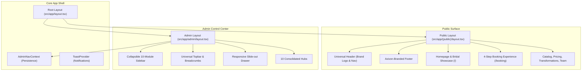
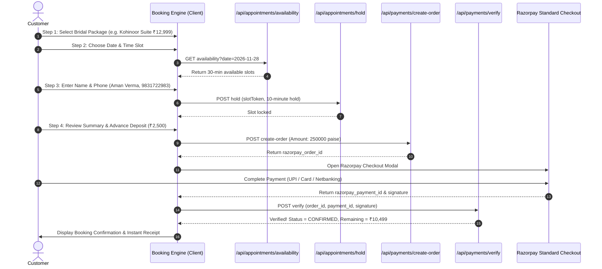

# Frontend Architecture Documentation: The Jawed Habib Salon – Lalganj

> **Document Status**: Production Verified  
> **Framework**: Next.js 14.2.20 (App Router) | **React**: 18.3.1 | **Language**: TypeScript 5.6.3 (Strict)  
> **Styling System**: Tailwind CSS 3.4.15 with Custom Luxury Palette Tokens  
> **Developer Attribution**: Designed & Developed by [Axivon Technologies](https://axivontech.in)

---

## 1. Architectural Principles & Overview

The frontend architecture is designed to project the international elegance of **The Jawed Habib** brand while providing ultra-fast, responsive performance across mobile and desktop devices. It utilizes the Next.js 14 App Router to balance Server-Side Rendering (SSR), Static Site Generation (SSG), and interactive Client Components (`"use client"`).



---

## 2. Design System & Styling Architecture

The visual theme adheres to an editorial, high-end salon standard built directly into `tailwind.config.ts`:

### A. Core Color Tokens
- **Luxury Black**: `#111111` (`bg-salon-black`) and Rich Deep Black `#0B0B0B` (`bg-salon-richBlack`) establish depth and contrast.
- **Card Surface Black**: `#181818` (`bg-salon-cardBlack`) and `#2A2A2A` (`border-salon-borderBlack`) for subtle component isolation.
- **Champagne Gold**: `#C6A56B` (`text-salon-gold`, `border-salon-gold`), `#DFCA9E` (`salon-goldLight`), and `#9E7E44` (`salon-goldDark`) provide refined metallic accents.
- **Habib Ruby Red**: `#C62628` (`bg-salon-red`), `#A81E20` (`salon-redDark`), and `#E03B3D` (`salon-redLight`) for brand accents and high-priority action cues.
- **Warm Contrast Typography**: `#F7F4EE` (`text-salon-ivory`), `#8E8E93` (`text-salon-mutedGrey`), and `#777777` (`text-salon-grey`).

### B. Typography Hierarchy
- **Editorial Headings (`font-serif`)**: Uses Playfair Display for grand hero statements, category headers, and luxury package titles.
- **Modern Sans-Serif (`font-sans`)**: Uses Inter for crisp body copy, metadata, timestamps, and input fields.
- **Monospace Numbers (`font-mono`)**: Used for phone numbers (`+91 7707000463`), booking IDs (`JH-LAL-2026-0001`), and financial currency displays.

---

## 3. Directory & Component Structure

All frontend source code resides under `src/`:

```
src/
├── app/
│   ├── (auth)/                    # Customer authentication portal
│   │   ├── forgot-password/page.tsx
│   │   ├── login/page.tsx
│   │   └── register/page.tsx
│   ├── (public)/                  # Customer-facing storefront pages
│   │   ├── about/page.tsx
│   │   ├── booking/page.tsx       # Dynamic booking journey
│   │   ├── consultation/page.tsx  # Interactive bridal questionnaire
│   │   ├── contact/page.tsx       # Location, maps, and verified contacts
│   │   ├── faq/page.tsx           # Accordion FAQ
│   │   ├── gallery/page.tsx       # Salon interior gallery
│   │   ├── offers/page.tsx        # Promotional bridal packages
│   │   ├── packages/page.tsx      # Tiered bridal suites
│   │   ├── page.tsx               # Homepage landing
│   │   ├── pricing/page.tsx       # Transparent rate card
│   │   ├── privacy/page.tsx       # Privacy policy
│   │   ├── services/page.tsx      # Categorized service catalogue
│   │   ├── stylists/page.tsx      # Master stylists directory
│   │   ├── team/page.tsx          # Team profile cards
│   │   ├── terms/page.tsx         # Booking terms & cancellation policy
│   │   └── transformations/page.tsx # Before/After interactive slider
│   └── admin/                     # 10 Consolidated Admin Modules
│       ├── bookings/page.tsx      # Bookings Hub (Merged appointments & bridal)
│       ├── calendar/page.tsx      # Calendar Hub (Merged schedule & settings)
│       ├── content/page.tsx       # Website CMS Hub
│       ├── customers/page.tsx     # Client directory & styling history
│       ├── dashboard/page.tsx     # KPI analytics dashboard
│       ├── login/page.tsx         # Secured administrative login
│       ├── media/page.tsx         # Media asset library
│       ├── payments/page.tsx      # Payments Hub & counter balance collection
│       ├── reports/page.tsx       # Reporting & CSV exports
│       ├── services/page.tsx      # Services & Packages Hub
│       ├── settings/page.tsx      # Salon configuration & Razorpay security
│       └── [legacy aliases]       # Backward-compatible re-exports
├── components/
│   ├── admin/                     # Reusable admin module hubs
│   │   ├── bookings-management-hub.tsx
│   │   ├── calendar-management-hub.tsx
│   │   ├── image-uploader.tsx
│   │   ├── payments-management-hub.tsx
│   │   ├── services-management-hub.tsx
│   │   └── settings-management-hub.tsx
│   ├── layout/                    # Shell navigation & structural chrome
│   │   ├── admin-nav-context.tsx  # Sidebar collapse & mobile drawer state
│   │   ├── admin-sidebar.tsx      # Collapsible 10-module navigation dock
│   │   ├── admin-topbar.tsx       # Dynamic breadcrumbs & actions
│   │   ├── footer.tsx             # Public footer with Axivon Technologies branding
│   │   └── header.tsx             # Universal public header with sticky blur
│   ├── public/                    # Homepage & booking visual components
│   │   ├── beyond-bridal-section.tsx
│   │   ├── brand-marquee.tsx
│   │   ├── bridal-booking-experience.tsx
│   │   ├── bridal-consultation-section.tsx
│   │   ├── bridal-portfolio-section.tsx
│   │   └── hero-video-section.tsx
│   ├── shared/                    # Interactive shared widgets
│   │   ├── before-after-slider.tsx
│   │   ├── breadcrumbs.tsx
│   │   ├── floating-contact.tsx   # Sticky WhatsApp and phone CTA
│   │   ├── lightbox-modal.tsx
│   │   └── loading-state.tsx
│   └── ui/                        # Low-level primitives
│       ├── accordion.tsx, badge.tsx, brand-logo.tsx, button.tsx, card.tsx, input.tsx, modal.tsx, toast.tsx
```

---

## 4. Route Inventory & Navigation Map

### A. Public Routes (17 Static / Dynamic Pages)
1. `/` — Flagship landing page: Hero video, Kurji-inspired bridal presentation, Before/After slider, testimonials, FAQ, and footer.
2. `/booking` — Multi-step dynamic booking journey.
3. `/services` — Complete service menu with category filtering.
4. `/packages` — Curated bridal suites with inclusions and advance deposit rules.
5. `/pricing` — Transparent rates with starting prices.
6. `/transformations` — Real bride before & after interactive split-screen slider.
7. `/gallery` — High-resolution photos of the Lalganj salon interior and styling stations.
8. `/consultation` — Personalized hair and bridal recommendation questionnaire.
9. `/team` & `/stylists` — Profiles of senior stylists trained in Habib precision techniques.
10. `/offers` — Seasonal festival and wedding promotion packages.
11. `/contact` — Exact physical address, Google Maps interactive link, and phone numbers.
12. `/faq` — Accordion FAQ covering appointment scheduling, prep tips, and payments.
13. `/privacy` & `/terms` — Salon legal policies and terms of service.
14. `/robots.txt` & `/sitemap.xml` — Search engine indexation configurations.

### B. Customer Authentication Routes
1. `/login` — Client Privilege Portal sign-in.
2. `/register` — Account registration with loyalty profile initialization.
3. `/forgot-password` — Secure PIN-based password reset.

### C. Admin Control Center (10 Consolidated Modules)
1. `/admin/dashboard` — KPI cards (Total Bookings, Today's Visits, Advance Collected, Remaining Due), status breakdown, and 6-month revenue trend.
2. `/admin/bookings` — Unified Bookings Hub with real-time status tabs, instant customer search, Reschedule modal, and Cancel dialog. *(Re-exported for `/admin/appointments` and `/admin/bridal/bookings`)*.
3. `/admin/services` — Service catalog and bridal package tier builder. *(Re-exported for `/admin/bridal/services` and `/admin/packages`)*.
4. `/admin/customers` — Client directory with lifetime spend metrics and customer styling notes editor.
5. `/admin/payments` — Financial ledger, Razorpay gateway status, and counter balance cash/UPI collection. *(Re-exported for `/admin/bridal/payments`)*.
6. `/admin/content` — Visual CMS for website hero, banner promotions, highlights, and FAQ items.
7. `/admin/media` — Media asset repository with categorized folders (`bridal`, `interior`, `transformations`).
8. `/admin/calendar` — 7-day visual scheduling grid and working hours configurator. *(Re-exported for `/admin/calendar-settings` and `/admin/bridal/calendar`)*.
9. `/admin/reports` — Exportable reporting center with CSV downloads for bookings, revenue, and clients. *(Re-exported for `/admin/analytics`)*.
10. `/admin/settings` — Verified salon ground truth (Tinpulwa Chowk, 10 AM - 10 PM), admin permissions, and AES-256-GCM Razorpay encryption. *(Re-exported for `/admin/settings/razorpay`)*.
11. `/admin/login` — Secured administrative sign-in with zero exposed credentials and Suspense boundary.

---

## 5. Booking Flow & State Management

The public booking interface ([`bridal-booking-experience.tsx`](file:///c:/Users/vk010/Downloads/startup/demo/The%20Jawed%20Habib%20Salon%20-%20Lalganj/src/components/public/bridal-booking-experience.tsx)) executes a 4-step progressive state machine:



---

## 6. Performance & Loading Optimizations

1. **Shared Chunks & Bundle Splitting**:
   - Total First Load JS shared by all routes: **87.2 kB**.
   - Common chunks segregated into `chunks/2117-*.js` (31.6 kB) and `chunks/fd9d1056-*.js` (53.6 kB).
2. **Client-Side Data Slicing**:
   - Admin tables process data in-memory after initial fetch, eliminating server latency for status filtering (`All`, `Today's Visits`, `Upcoming`, `Pending`, `Confirmed`).
3. **Asset Optimization**:
   - Next.js Image component handles automatic WebP conversion and responsive `srcset` generation.
   - Video elements utilize preload heuristics (`preload="metadata"` and lightweight poster images).
4. **Zero Layout Shift (CLS)**:
   - Skeletons and empty states defined in `src/components/shared/loading-state.tsx`.
   - Modals and drawers leverage Framer Motion `AnimatePresence` to prevent DOM jumping.
