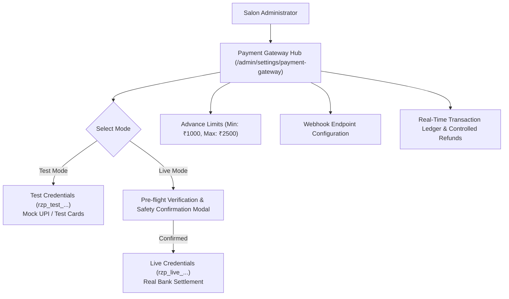

# Razorpay Payment Gateway Setup & Operations Guide
## The Jawed Habib Salon – Lalganj

> **Document Version**: 3.0.0 (Production Verified)  
> **Target Gateway**: Razorpay Standard Checkout & REST API v1  
> **Security Protocol**: Authenticated AES-256-GCM Encryption with Server-Side Key Derivation  
> **Dedicated Admin Portal**: `/admin/settings/payment-gateway`

---

## 1. System Overview

The payment infrastructure of **The Jawed Habib Salon – Lalganj** is engineered for absolute reliability, strict environment isolation, and cryptographic credential security.

### Core Capabilities:
- **Two Completely Segregated Payment Environments**: Test Sandbox Mode (`TEST`) and Live Production Mode (`LIVE`).
- **Encrypted Secrets Storage**: API keys and webhook secrets are encrypted at rest using `aes-256-gcm`.
- **Zero Plaintext Exposure**: Public APIs, frontend forms, and server logs never output raw secrets. Credentials appear masked as `••••••••••••`.
- **Dynamic Advance Deposit Control**: Configurable minimum advance (₹1,000), maximum advance (₹2,500), and policy enforcement for sub-minimum service bills.
- **Autonomous Webhook Engine**: Signature-verified webhook processing with event deduplication (`WebhookEventLog`) to prevent double-crediting.
- **Salon Counter Offline Collection**: Cash and counter UPI balance tracking with atomic status reconciliation.

---

## 2. Admin Panel Configuration (`/admin/settings/payment-gateway`)

Administrators configure, monitor, and audit payment processing from the dedicated management portal:

### Configuration Steps:
1. Navigate to **Admin Dashboard → Settings → Payment Gateway**.
2. **Configure Test Credentials**:
   - Input your Test Key ID (`rzp_test_...`).
   - Input your Test Key Secret.
   - Input your Test Webhook Secret.
   - Click **Probe Test API** to test authentication with the Razorpay REST API.
3. **Configure Live Credentials**:
   - Input your verified merchant Live Key ID (`rzp_live_...`).
   - Input your Live Key Secret.
   - Input your Live Webhook Secret.
   - Click **Probe Live API** to test connectivity.
4. **Set Advance Deposit Rules**:
   - Default Minimum Advance: `₹1,000`
   - Default Maximum Advance: `₹2,500`
   - Below Minimum Policy: `Cap Advance at Service Total` (e.g., ₹399 haircut only charges ₹399).
5. Click **Save Settings & Encrypt** to persist the encrypted configuration to Neon PostgreSQL.

---

## 3. Webhook Setup & Event Subscriptions

Razorpay webhooks autonomously update appointment booking states when payments or refunds succeed or fail asynchronously.

### Webhook Coordinates:
- **Production Webhook URL**:  
  `https://thejawedhabibsalons.in/api/webhooks/razorpay`
- **Secret**: Stored in `testWebhookSecret` or `liveWebhookSecret` (AES-256-GCM encrypted).

### Required Webhook Event Subscriptions:
1. `order.paid`: Triggered when an order is completed.
2. `payment.captured`: Confirms funds transfer; updates booking to `PARTIALLY_PAID` or `PAID`.
3. `payment.failed`: Records failed checkout transaction with failure diagnostics without crediting the booking.
4. `refund.processed`: Confirms payment refund and updates appointment status to `REFUNDED`.

---

## 4. Live Mode Activation Safety Protocol

Live Mode processes actual customer funds and settles money into the salon's bank account. It **cannot** be activated automatically.

### Mandatory Pre-Flight Checklist:
1. **Live Key ID**: Must start with `rzp_live_` and be non-empty.
2. **Live Secret**: Must be configured and encrypted.
3. **Live Webhook Secret**: Must be configured and verified.
4. **REST API Connectivity**: Verified via `testRazorpayConnection`.
5. **Production Domain & HTTPS**: Must run over secure HTTPS on `thejawedhabibsalons.in`.
6. **Explicit Admin Acknowledgment**: When toggling to LIVE, the administrator must check the acknowledgment box on the caution modal:
   > *"I have verified the Live Key ID, Secret, and Webhooks, and I explicitly authorize real payment processing."*

---

## 5. Payment Mode Isolation Rules

The system strictly enforces payment mode isolation at the database and application levels:
- Every `RazorpayOrderRecord` records `environment: "TEST" | "LIVE"`.
- A payment initiated with a `pay_test_...` token **cannot** confirm a `LIVE` booking order.
- A test order cannot be credited with a real-money live transaction.
- If an environment mismatch is detected, the verification endpoint returns `400 Bad Request` with:
  `"Security Violation: Cannot verify a LIVE booking order with a TEST payment instrument."`

---

## 6. Key Rotation & Disaster Recovery Procedure

To rotate API credentials without interrupting customer bookings:
1. Generate a new API Key in the official [Razorpay Dashboard](https://dashboard.razorpay.com).
2. Open the Admin Panel at `/admin/settings/payment-gateway`.
3. Paste the new Key ID and Secret into Section 3.
4. Click **Probe Live API** to verify authentication.
5. Click **Save Settings & Encrypt**. The system encrypts the new secret and updates Neon PostgreSQL.
6. Conduct a ₹1 test transaction in the salon to verify end-to-end capture.
7. Once verified, revoke the old key in the Razorpay Dashboard.
