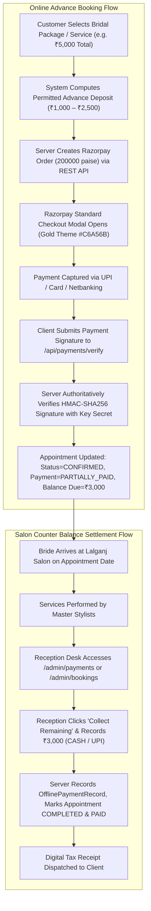
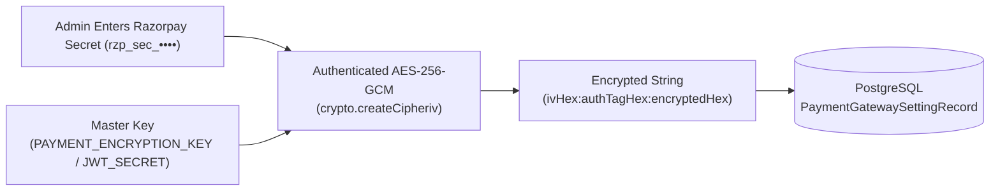

# Payment System & Razorpay Integration Architecture
# The Jawed Habib Salon – Lalganj

> **Document Version**: 2.0.0 (Production Verified & Idempotent)  
> **Primary Payment Provider**: Razorpay (REST API v1 & Standard Checkout)  
> **Counter Collection**: In-Salon Reception Counter (Cash, UPI QR, POS Card)  
> **Security Standards**: Authenticated AES-256-GCM Credential Encryption, HMAC-SHA256 Signatures, Timing-Safe String Comparison, Webhook Event Deduplication  
> **Developer Attribution**: Designed & Engineered by [Axivon Technologies](https://axivontech.in)

---

## 1. Executive Summary & Dual-Channel Financial Model

The payment infrastructure of **The Jawed Habib Salon – Lalganj** is architected for a hybrid bridal salon workflow:
1. **Online Advance Booking Deposits**: Customers pay an initial reservation deposit online via Razorpay (UPI, Credit/Debit Cards, Net Banking) to guarantee stylist availability and hold their wedding or salon slot.
2. **Salon Counter Balance Settlement**: On the day of service, the client pays the remaining balance at the salon reception desk. The front desk records this offline payment (Cash, Reception UPI, Card POS), which automatically reconciles the account and issues a digital itemized receipt.

---

## 2. The 6-Phase Payment Lifecycle

### Phase A: Order Creation (`/api/payments/create-order`)
When a customer selects a service and chooses an advance payment:
1. **Server-Side Price Authority**: The server retrieves the actual service or package price directly from the database using `dbRepo.getServiceById` or `dbRepo.getPackageById`. **The client-submitted price is never trusted**.
2. **Advance Calculation**: The advance deposit is validated between ₹1,000 and ₹2,500 (or capped at total service price if lower) in accordance with salon configuration.
3. **Paise Conversion**: Converts INR to integer paise to eliminate floating-point rounding errors:
   $$\text{amountInPaise} = \text{Math.round}(\text{payableINR} \times 100)$$
4. **Order Creation**: Outbound HTTPS request to Razorpay REST API (`POST https://api.razorpay.com/v1/orders`) with strict 8-second timeout (`AbortSignal.timeout(8000)`).
5. **Database Storage**: The order is recorded in `RazorpayOrderRecord` with `orderId`, `amountInPaise`, `purpose: "ADVANCE_DEPOSIT"`, and audit metadata.
6. **Public Checkout Payload**: Returns only safe public checkout parameters (`orderId`, `keyId`, `amount`, `amountInPaise`, `currency`, `appointmentId`, `appointmentNumber`). **Secrets are never returned**.

### Phase B: Payment Checkout (Razorpay Standard Checkout)
1. **Client Modal**: The client browser loads `https://checkout.razorpay.com/v1/checkout.js`.
2. **Visual Transparency**: The checkout modal clearly displays:
   - Unique Booking ID (`JH-LAL-2026-XXXX`).
   - Selected bridal package or service name.
   - Total service amount.
   - Advance amount payable today.
   - Remaining balance payable at salon.
   - Luxury brand styling in Champagne Gold (`#C6A56B`).
   - Customer details pre-filled (Name, Phone, Email).

### Phase C: Payment Verification (`/api/payments/verify`)
1. **Cryptographic Signature Verification**:
   The backend authoritatively verifies the payment signature using HMAC-SHA256:
   $$\text{Expected Signature} = \text{HMAC-SHA256}(\text{order\_id} + "|" + \text{payment\_id}, \text{keySecret})$$
2. **Constant-Time Comparison**: `timingSafeEqualString` uses `crypto.timingSafeEqual` to eliminate timing attack vectors.
3. **Amount Reconciliation**: Verifies that the captured amount matches the original order amount.
4. **Safe Status Update**:
   - If signature is valid: marks transaction as `SUCCESS`, updates appointment payment status to `PARTIALLY_PAID` (or `PAID`), and promotes appointment status from `PENDING` to `CONFIRMED`.
   - If signature is invalid: records transaction as `FAILED`, returns HTTP 400 error, and preserves the appointment in `PENDING` state.
5. **Frontend Callback Safety**: The system never trusts frontend callbacks alone; verification occurs strictly server-side.

### Phase D: Asynchronous Webhook Integration (`/api/webhooks/razorpay`)
In situations where a user closes their browser immediately after payment capture, Razorpay webhooks guarantee 100% order capture:
1. **Signature Verification**: Validates the `X-Razorpay-Signature` header using the raw request body text (`req.text()`) and the configured webhook secret.
2. **Idempotency & Deduplication**:
   - Every event ID is recorded in `WebhookEventRecord` with a `@unique` constraint in PostgreSQL.
   - Duplicate webhook deliveries are detected (`eventRecord.isDuplicate === true`) and acknowledged immediately with `HTTP 200 OK` without creating duplicate payments or re-crediting balances.
3. **Supported Events**:
   - `payment.captured`: Confirms the appointment and updates `PaymentRecord` to `SUCCESS`.
   - `payment.failed`: Records failure reason in `PaymentRecord` for administrative auditing.
   - `order.paid`: Confirms complete order settlement.
   - `refund.processed`: Records refund reference and reconciles appointment payment balance.

### Phase E: Advance Payment & Remaining Balance Rules
- **Advance Deposit Range**: Configured between ₹1,000 and ₹2,500.
- **Service Price Guard**: If the total service price is less than ₹1,000, the advance is capped at the total service price.
- **Outstanding Balance Protection**: When recording offline payments at the salon counter (`/api/bridal/payments/collect-remaining`), the collected amount is strictly validated to never exceed the outstanding balance:
  $$\text{Collected Amount} \le \text{Outstanding Balance}$$
- **Automatic Reconciliation**: When the remaining balance reaches ₹0, the appointment transitions automatically to `paymentStatus: PAID` and `status: CONFIRMED` or `COMPLETED`.

### Phase F: Refund Management (`createRazorpayRefund`)
- Supports administrative partial or full refunds through Razorpay REST API (`POST https://api.razorpay.com/v1/payments/{payment_id}/refund`).
- Audit record created in `PaymentRefundRecord` storing `razorpayRefundId`, `amount`, `reason`, and `initiatedBy`.
- Booking status transitions to `REFUNDED` only after successful gateway verification.

---

## 3. Credential Encryption & Data Protection

Administrative Razorpay credentials (Key Secret and Webhook Secret) are protected with **authenticated AES-256-GCM encryption** before being saved to PostgreSQL:

- **Masked UI Projection**: Admin APIs return masked strings (`••••••••••••`) preventing credential exposure.
- **Zero Client Exposure**: Razorpay Key Secret and Webhook Secret are **never** delivered to client components or public endpoints.

---

## 4. Setup Guide for Razorpay Credentials

### Step 1: Obtain Razorpay Test Mode Credentials
1. Log in to [Razorpay Dashboard](https://dashboard.razorpay.com).
2. Switch to **Test Mode** using the top header toggle.
3. Navigate to **Account & Settings** > **API Keys**.
4. Generate Test Keys:
   - Note the **Key ID** (`rzp_test_...`).
   - Note the **Key Secret**.

### Step 2: Configure Webhook Secret
1. In Razorpay Dashboard, navigate to **Account & Settings** > **Webhooks**.
2. Click **Add New Webhook**:
   - **Webhook URL**: `https://yourdomain.com/api/webhooks/razorpay`
   - **Secret**: Enter a strong secret string (e.g. `openssl rand -hex 16`).
   - **Alert Email**: Enter your operations email.
   - **Active Events**: Check `payment.captured`, `payment.failed`, `order.paid`, `refund.processed`.
3. Save the Webhook.

### Step 3: Configure Application Settings
Enter these credentials either:
- In `.env` / environment variables: `RAZORPAY_KEY_ID`, `RAZORPAY_KEY_SECRET`, `RAZORPAY_WEBHOOK_SECRET`.
- Or directly in the Admin Panel at `/admin/settings` (under the **Razorpay Gateway** tab), which encrypts them into PostgreSQL via AES-256-GCM.
- Click **Test Gateway Connection** to verify live communication with Razorpay.
