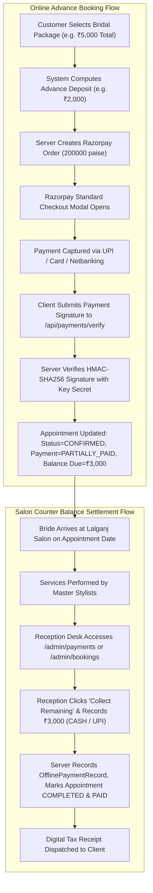
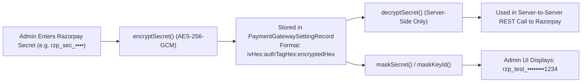

# Payment System & Razorpay Integration Architecture

> **Document Status**: Production Verified  
> **Payment Provider**: Razorpay (Primary Online Payment Gateway)  
> **Counter Collection**: In-Salon Reception Counter (Cash, UPI QR, Card)  
> **Security Standard**: Authenticated AES-256-GCM Credential Encryption & Constant-Time Signature Verification  
> **Developer Attribution**: Designed & Developed by [Axivon Technologies](https://axivontech.in)

---

## 1. Payment Processing Overview

The payment infrastructure is architected to support the hybrid financial model typical of luxury bridal salons in India:
1. **Online Advance Booking Deposits**: Customers pay an initial reservation deposit online via Razorpay (UPI, Credit/Debit Cards, Net Banking) to guarantee stylist availability and hold their 30-minute booking slot.
2. **Salon Counter Balance Settlement**: On the day of service, the client pays the remaining balance at the salon reception desk. The front desk records this offline payment (Cash, Reception UPI, Card POS), which automatically reconciles the account and issues a final tax invoice.



---

## 2. Technical Implementation Specifications

### A. Razorpay Client Library ([`src/lib/payments/razorpay.ts`](file:///c:/Users/vk010/Downloads/startup/demo/The%20Jawed%20Habib%20Salon%20-%20Lalganj/src/lib/payments/razorpay.ts))
Rather than relying on third-party wrapper dependencies that may introduce unvetted code, the system communicates directly with the **Razorpay REST API v1** using Node.js HTTPS clients with strict timeout controls:
- **Order Creation Endpoint**: `POST https://api.razorpay.com/v1/orders`
- **Payment Verification**: Native HMAC-SHA256 signature generation via Node.js `crypto`.
- **Refund Endpoint**: `POST https://api.razorpay.com/v1/payments/{payment_id}/refund`
- **Timeout Protection**: All outbound gateway requests enforce an `AbortSignal.timeout(8000)` (8-second threshold) to prevent hanging server processes.

### B. Advance vs. Balance Financial Logic
When an appointment is created:
1. **Total Amount Calculation**: Aggregates base service/package pricing, applies coupon discounts, and computes net payable amount.
2. **Deposit Computation**:
   - For services with `minAdvanceAmount` defined (e.g. Bridal Artistry suites), the deposit is set to the minimum advance threshold.
   - For general appointments, the deposit is set to a fixed deposit or 100% of the service total.
3. **Paise Conversion**: All financial values sent to Razorpay are multiplied by 100 to convert to Indian Paise (`₹1 = 100 paise`), preventing floating-point rounding errors.
4. **Remaining Balance Tracking**:
   $$\text{Remaining Amount} = \text{Total Amount} - \text{Deposit Amount}$$
   Stored authoritatively in `Appointment.remainingAmount`.

---

## 3. Cryptographic Signature Verification & Webhook Architecture

### A. Checkout Payment Verification (`/api/payments/verify`)
When the Razorpay checkout modal completes on the client browser, it receives three attributes:
- `razorpay_order_id`
- `razorpay_payment_id`
- `razorpay_signature`

The backend authoritatively verifies this payload before marking any booking as confirmed:
```ts
const expectedSignature = crypto
  .createHmac("sha256", decryptedKeySecret)
  .update(`${orderId}|${paymentId}`)
  .digest("hex");

const isValid = timingSafeEqualString(expectedSignature, signature);
```
- **Constant-Time Comparison**: `timingSafeEqualString` leverages `crypto.timingSafeEqual` to eliminate timing attack vectors.
- **Idempotency**: If the order has already been marked as `PAID`, subsequent verification requests return the existing confirmed record without creating duplicate payment entries.

### B. Asynchronous Webhooks (`/api/webhooks/razorpay`)
In situations where a user loses internet connectivity immediately after payment capture, the Razorpay webhook ensures zero dropped bookings:
- **Signature Verification**: Validates the `X-Razorpay-Signature` header using the decrypted webhook secret.
- **Event Deduplication**: Every event is checked against `WebhookEventRecord`. Duplicate event deliveries from Razorpay are acknowledged with `200 OK` without re-executing transactions.
- **Event Handling**:
  - `payment.captured`: Confirms the appointment and updates `PaymentRecord` to `SUCCESS`.
  - `payment.failed`: Records payment failure in `PaymentRecord` and logs alert.
  - `refund.processed`: Updates `PaymentRefundRecord` and reconciles appointment payment status.

---

## 4. Credential Security & AES-256-GCM Encryption

Administrative payment gateway credentials are never stored in plaintext in the database or exposed via public APIs:



1. **Authenticated Encryption Algorithm**: **AES-256-GCM** (Galois/Counter Mode).
2. **Cryptographic Primitives**:
   - Random 12-byte (96-bit) Initialization Vector (IV) generated per encryption.
   - 16-byte (128-bit) authentication tag verifies data integrity.
   - Encryption key derived from server environment secret `JWT_SECRET` / `PAYMENT_ENCRYPTION_KEY` using `crypto.scryptSync`.
3. **Public API Shielding**:
   - Public and administrative GET requests strictly mask credentials (`maskKeyId` and `maskSecret`), outputting safe strings such as `rzp_test_••••••••4821`.
   - Plaintext secrets are never serialized in JSON responses, frontend bundles, or error logs.

---

## 5. Counter Balance Collection (`/api/bridal/payments/collect-remaining`)

For appointments with an outstanding balance:
1. Reception desk opens the booking in the **Payments Hub** ([`/admin/payments`](file:///c:/Users/vk010/Downloads/startup/demo/The%20Jawed%20Habib%20Salon%20-%20Lalganj/src/app/admin/payments/page.tsx)).
2. Desk selects payment method (`CASH`, `UPI`, `CARD`), enters collected amount, and inputs receiving manager's name.
3. Server records an `OfflinePaymentRecord`, decrements `remainingAmount`, and updates `Appointment.paymentStatus` to `PAID` and `Appointment.status` to `COMPLETED`.
4. An authoritative digital tax invoice receipt is generated via `/api/payments/receipt/[id]`.
